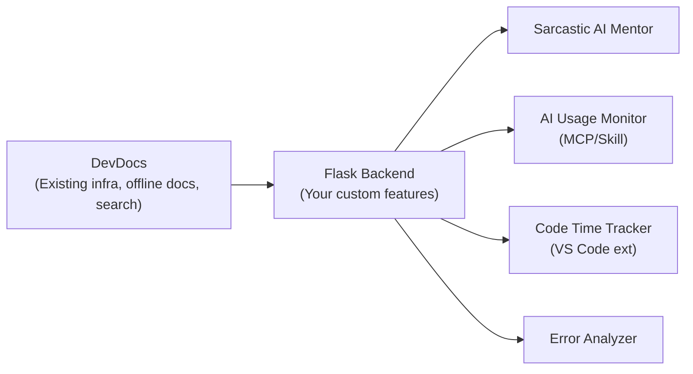
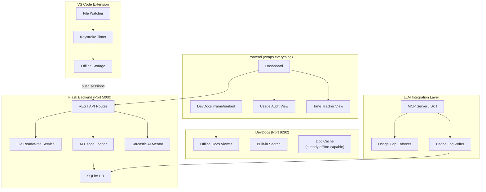

# The Rule of Thumb — Architecture Plan

> Hack Club Phantom Project · Target: 40 hours of logged coding time
> You code. I assist. I'm one-third of this project.

---

## Project Overview

An offline-first app built **on top of DevDocs**. We use DevDocs' existing docs infra and layer our custom features around it.



---

## System Architecture



> [!NOTE]
> DevDocs runs as its own process (Docker or local Ruby). Your Flask backend doesn't re-implement docs — it just sits next to DevDocs and handles the custom features. The frontend wraps both into one UI.

---

## How DevDocs Fits In

DevDocs (`github.com/freeCodeCamp/devdocs`) gives you **for free**:
- ✅ Offline documentation for 400+ languages/frameworks
- ✅ Full-text search across all cached docs
- ✅ Works in-browser, no internet needed once docs are downloaded
- ✅ Run via Docker: `docker run -d -p 9292:9292 ghcr.io/freecodecamp/devdocs:latest`
- ✅ Or manual install: clone → `bundle install` → `bundle exec thor docs:download python javascript` → `bundle exec rackup`

**What you DON'T need to build:**
- ~~Doc scraper/packager~~ — DevDocs already does this
- ~~Docs viewer~~ — DevDocs already has one
- ~~Search index~~ — DevDocs already has one

**What you DO build on top:**
- Your Flask API that links errors → relevant DevDocs pages
- The sarcastic mentor that tells users "go read the docs" and points them there
- The AI usage monitor/MCP that integrates with LLMs
- The code time tracker VS Code extension

---

## The 5 Systems — Build Order

### Phase 1: Foundation (Week 1) — ~10 hours

| Step | What to Build | You Code | I Assist With |
|------|--------------|----------|---------------|
| 1.1 | **Reorganize `main.py`** — split into Flask blueprints: `/api/files/`, `/api/audit/` | ✅ | Review, suggest structure |
| 1.2 | **SQLite database** — schema for AI usage logs, coding sessions, project metadata | ✅ | Schema design |
| 1.3 | **File service** — clean up read/write endpoints, add directory listing | ✅ | Error handling patterns |
| 1.4 | **Project config** — `requirements.txt`, `.env`, `.gitignore`, Docker setup for DevDocs | ✅ | What to include |

### Phase 2: DevDocs Integration (Week 1-2) — ~3 hours

| Step | What to Build | You Code | I Assist With |
|------|--------------|----------|---------------|
| 2.1 | **Run DevDocs locally** — Docker or manual install, pick your docs (Python, JS, etc.) | ✅ | Setup commands, troubleshooting |
| 2.2 | **Embed DevDocs in your frontend** — iframe or proxy it through your Flask app | ✅ | Proxy route pattern |
| 2.3 | **Deep-link API** — Flask endpoint that takes an error/topic and returns a DevDocs URL | ✅ | DevDocs URL structure |

### Phase 3: AI Usage Monitor & Sarcastic Mentor (Week 2-3) — ~12 hours

| Step | What to Build | You Code | I Assist With |
|------|--------------|----------|---------------|
| 3.1 | **MCP Server skeleton** — register as an MCP tool that LLMs call | ✅ | MCP protocol spec |
| 3.2 | **Usage tracker** — count tokens/calls, enforce caps, log everything | ✅ | Cap logic, rate limiting patterns |
| 3.3 | **Sarcastic mentor** — refuses to code, tells you to read the DevDocs page instead | ✅ | Prompt engineering ideas |
| 3.4 | **Audit dashboard API** — endpoints to query usage logs per project | ✅ | Query patterns |

### Phase 4: Code Time Tracker (Week 3-4) — ~10 hours

| Step | What to Build | You Code | I Assist With |
|------|--------------|----------|---------------|
| 4.1 | **VS Code extension** — detect keystrokes, file saves, active window | ✅ | Extension API docs |
| 4.2 | **Offline-first storage** — SQLite log of coding sessions, no network needed | ✅ | Schema, sync strategy |
| 4.3 | **Multi-project tracking** — detect which project is active, track separately | ✅ | Workspace detection logic |
| 4.4 | **Dashboard endpoint** — daily/weekly coding hours, per-project breakdown | ✅ | Aggregation queries |

### Phase 5: Error Analyzer + UI (Week 4) — ~5 hours

| Step | What to Build | You Code | I Assist With |
|------|--------------|----------|---------------|
| 5.1 | **Error parser** — catch errors from terminal/logs, categorize them | ✅ | Regex patterns, error taxonomy |
| 5.2 | **Link errors to DevDocs** — match error type → relevant DevDocs page URL | ✅ | Matching strategy, DevDocs URL patterns |
| 5.3 | **Dashboard UI** — HTML/CSS frontend that wraps DevDocs + tracker + audit in one view | ✅ | Layout suggestions |

---

## Directory Structure (Target)

```
The rule of thumb/
├── backend/
│   ├── app.py                  # Flask app factory
│   ├── config.py               # Paths, DevDocs URL, DB path
│   ├── routes/
│   │   ├── files.py            # File read/write endpoints
│   │   ├── audit.py            # AI usage audit endpoints
│   │   ├── devdocs.py          # Proxy/deep-link to DevDocs
│   │   └── tracker.py          # Code time tracker endpoints
│   ├── models/
│   │   └── database.py         # SQLite models
│   ├── services/
│   │   ├── usage_monitor.py    # AI usage cap logic
│   │   └── mentor.py           # Sarcastic AI mentor
│   └── requirements.txt
├── mcp/
│   └── server.py               # MCP server for LLM integration
├── vscode-extension/
│   ├── extension.js            # VS Code time tracker
│   └── package.json
├── frontend/
│   ├── index.html              # Dashboard that embeds DevDocs + your features
│   ├── css/
│   └── js/
├── docs/
│   ├── idea,md                 # Original brain dump (keep it raw)
│   └── image.png
├── data/
│   └── ruleofthumb.db          # SQLite database
├── docker-compose.yml          # DevDocs + your Flask app together
├── README.md
└── .gitignore
```

---

## Immediate Next Step

> [!IMPORTANT]
> **Step 1.1 — Reorganize `main.py` into a proper Flask app structure.**
>
> Your current `main.py` has two routes (`/Analyze/<file_name>` and `/Write/<file_path>`) with a hardcoded folder path. The `/Write` route is incomplete. This needs to become a proper Flask app with blueprints before we build anything on top.

**What you should do now:**
1. Create the `backend/routes/` folder
2. Move the file reading logic into `backend/routes/files.py` as a Flask Blueprint
3. Fix the incomplete `/Write` route — it needs to accept POST data and actually write
4. Replace the hardcoded path with a config variable
5. Create `backend/app.py` as the main entry point

When you've written it, show me and I'll review. I won't write it for you.

---

## Rules of Engagement

| Rule | Detail |
|------|--------|
| **You code** | You write every line. This is your 40-hour Phantom project. |
| **I review** | After you code something, show me. I'll review, point out issues, suggest improvements. |
| **I plan** | I help you figure out what to build next and how to structure it. |
| **I explain** | Confused about Flask blueprints? SQLite schemas? MCP protocol? I explain the concept, you implement. |
| **I don't code** | Unless you explicitly ask me to write a specific piece, I guide only. |
| **Your words** | Docs stay in your voice. I clean up structure, not tone. |

---

## Commit Convention

> [!IMPORTANT]
> Hack Club reviewers look at your commits. Every commit must be clean and descriptive.

**Format:** `<type>: <what changed>`

| Type | Use When |
|------|----------|
| `feat:` | Adding a new feature or functionality |
| `fix:` | Fixing a bug |
| `refactor:` | Restructuring code without changing behavior |
| `docs:` | Documentation changes (README, FEATURES, etc.) |
| `chore:` | Config, .gitignore, dependencies, build setup |
| `style:` | Formatting, no code logic change |
| `test:` | Adding or updating tests |

**Examples of good commits:**
```
feat: add file read endpoint with error handling
feat: add write endpoint with POST body support
refactor: split main.py into flask blueprints
docs: add README with project overview and features
docs: add detailed feature plan with hour estimates
chore: add .gitignore for python, node, sqlite
feat: scaffold MCP server for AI usage monitoring
feat: add VS Code extension with keystroke tracking
fix: handle missing file gracefully in /api/files
```

**Bad commits (avoid these):**
```
v1
did stuff
update
fix things
wip
```

---

## 40-Hour Budget

| Phase | Features | Hours | Running Total |
|-------|----------|-------|---------------|
| ✅ Already logged | Setup, ideation, initial `main.py` | 6h | 6h |
| Phase 1: Foundation | Backend API restructure | ~4h | 10h |
| Phase 2: DevDocs | Integration | ~3h | 13h |
| Phase 3: AI Core | Mentor + Monitor | ~12h | 25h |
| Phase 4: Tracker | VS Code Extension | ~10h | 35h |
| Phase 5: Polish | Error Analyzer + UI | ~5h | 40h |
